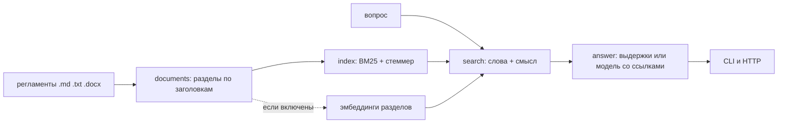

# docs-answers — поиск ответов по внутренним регламентам

Сотрудник спрашивает обычными словами: «сколько дней отпуска положено», «что делать, если потерял пропуск». Сервис находит нужный раздел регламента, отвечает выдержкой из него и показывает, откуда взят ответ. Если ответа в регламентах нет — так и говорит.

Работает целиком на своей машине: без облака, без ключей, без векторной базы. Языковая модель необязательна — она делает ответ связнее, но источником остаются те же найденные разделы.

```text
$ answers demo

Регламенты: examples/регламенты
Разделов в индексе: 25

— сколько дней отпуска положено
Ежегодный оплачиваемый отпуск составляет 28 календарных дней. Сотрудникам с ненормированным рабочим
днём добавляется 3 календарных дня, работникам до 18 лет предоставляется 31 календарный день. [1]

  [1] отпуска.md · Отпуска → Сколько дней отпуска положено

— можно ли пользоваться личной флешкой
Личные флешки и внешние диски подключать к рабочим компьютерам запрещено. Для передачи файлов
используйте корпоративное хранилище. [1]

  [1] информационная-безопасность.md · Информационная безопасность → Внешние носители
  [2] информационная-безопасность.md · Информационная безопасность → Удалённая работа и VPN

— какая погода завтра
В регламентах такого не нашлось. Уточните вопрос или спросите у кадровой службы.

Замер поиска на размеченных вопросах: вопросов — 26
  recall@1: 85%
  recall@3: 92%
  recall@5: 100%
  MRR: 0.90
  нашли хоть что-то: 100%
```

С включённой моделью ответ становится связным, а ссылки остаются теми же:

```text
$ ANSWERS_MODEL=ollama ANSWERS_MODEL_NAME=qwen3:4b answers ask "сколько дней отпуска положено и за сколько подавать заявление"

Ежегодный оплачиваемый отпуск составляет 28 календарных дней [1]. Заявление на отпуск подаётся
не позднее чем за 14 календарных дней до его начала [2].

[1] отпуска.md · Отпуска → Сколько дней отпуска положено
[2] отпуска.md · Отпуска → Как согласовать отпуск
```

## Что внутри

| Шаг | Как сделано |
|---|---|
| Разбор документов | .md, .txt и .docx режутся по заголовкам, а не по 1000 символов: у каждого куска остаётся путь «Отпуска → Как согласовать», он же становится ссылкой в ответе |
| Индекс | BM25 на чистом Python со своим лёгким стеммером; индекс — обычный JSON, его можно открыть и посмотреть |
| Поиск | слова обязательно, смысл — по желанию: если рядом есть сервис эмбеддингов, его близость подмешивается к словам с настраиваемым весом |
| Ответ | без модели — выдержки из найденных разделов; с моделью — связный текст, но только по тем же фрагментам и со ссылками |
| Защита от выдумок | если модель ответила, не сославшись ни на один фрагмент, её ответ не показывается; если поиск ничего не нашёл, сервис честно говорит об этом |
| Замер качества | recall@1/3/5 и MRR на размеченном наборе вопросов — после каждой правки поиска видно, стало лучше или хуже |

## Как запустить

```bash
uv sync
uv run answers demo                                   # индекс по примерам, несколько ответов и замер
uv run answers index --corpus регламенты --out индекс.json
uv run answers ask "как заказать монитор" --index индекс.json
uv run answers quality --questions вопросы.json --index индекс.json
uv run answers serve --index индекс.json --port 8000  # HTTP: POST /ask, GET /search, GET /health
```

| Переменная окружения | Зачем |
|---|---|
| `ANSWERS_MODEL` | `none` (по умолчанию), `ollama` или `openai` |
| `ANSWERS_MODEL_NAME`, `ANSWERS_MODEL_URL`, `ANSWERS_MODEL_KEY` | какая модель, где она и ключ (ключ — только для `openai`) |
| `ANSWERS_EMBEDDINGS`, `ANSWERS_EMBEDDINGS_NAME` | включить смысловой поиск и указать модель эмбеддингов |
| `ANSWERS_LIMIT`, `ANSWERS_WEIGHT` | сколько разделов брать и какой вес у смысловой близости (0…1) |

HTTP-ответ выглядит так:

```json
{
  "ответ": "Ежегодный оплачиваемый отпуск составляет 28 календарных дней. […] [1]",
  "нашли": true,
  "источник": "регламенты",
  "ссылки": [{"номер": 1, "раздел": "отпуска.md · Отпуска → Сколько дней отпуска положено", "текст": "…"}]
}
```

## Как устроено



| Модуль | Ответственность |
|---|---|
| `documents.py` | чтение .md, .txt, .docx; разбиение по заголовкам, длинные разделы — по предложениям с нахлёстом |
| `index.py` | токенизация, лёгкий стеммер, BM25, сохранение и загрузка индекса |
| `search.py` | смешивание словесного и смыслового поиска, эмбеддинги через Ollama |
| `answer.py` | выдержки, ответ модели, проверка ссылок, «ответа нет» |
| `quality.py` | recall@k, MRR, список вопросов, на которых поиск промахнулся |
| `api.py`, `cli.py` | HTTP-сервис и командная строка |

## Как проверялось

- `ruff format`, `ruff check` (E, F, W, I, B, UP, S — bandit, C4, SIM, PT, RUF, DTZ, ASYNC) и `mypy --strict` — без замечаний.
- `pytest` — 40 тестов за 0,7 с: разбор заголовков и .docx, нарезка длинных разделов, стеммер и BM25, сохранение индекса, смешивание с эмбеддингами, выдержки и ответы модели (в том числе «ответил без ссылок» и «модель недоступна»), метрики, HTTP-ручки и командная строка.
- Замер поиска на 26 размеченных вопросах к 25 разделам: recall@1 — 85%, recall@3 — 92%, recall@5 — 100%, MRR — 0,90. Порог зашит в тест: если поиск сломают, тест это заметит.
- Живой прогон 12.09.2026 с локальной моделью `qwen3:4b` через Ollama: ответ собран по фрагментам, ссылки [1] и [2] указывают на правильные разделы; на вопрос «какая завтра погода» модель ответила «В регламентах ответа нет». На этом же прогоне выяснилось, что qwen3 присылает рассуждение перед ответом (иногда даже без открывающего тега) — теперь оно вырезается, и на это есть тест.

### Не проверялось

- Смысловой поиск на настоящих эмбеддингах не измерялся: локальный сервер Ollama запущен без ключа `--embeddings` и отвечает на них 501. Код этого пути закрыт тестами с эмулятором и подставными векторами, но цифр качества «с эмбеддингами» у меня нет.
- Корпус синтетический: пять регламентов, 25 разделов. На тысячах страниц ни скорость, ни качество не проверялись.
- Стеммер лёгкий (обрезание окончаний), не Snowball: на редких словах он ошибается. Замер это учитывает, но отдельного сравнения со Snowball я не делал.
- Ответы модели проверены на одной модели и нескольких вопросах — это проверка работоспособности, а не оценка качества ответов.
- HTTP-сервис поднимался только локально: авторизации, ограничения частоты и журналирования запросов в нём нет.

## Структура

```text
src/answers/   documents, index, search, answer, quality, llm, config, api, cli
tests/         documents, index, search, answer, quality, api+cli
examples/      пять регламентов и 26 размеченных вопросов
```
